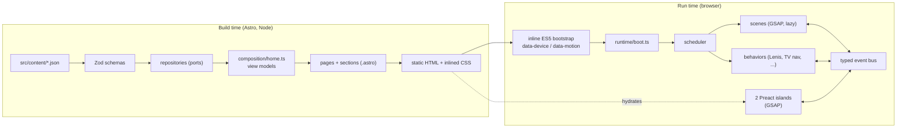
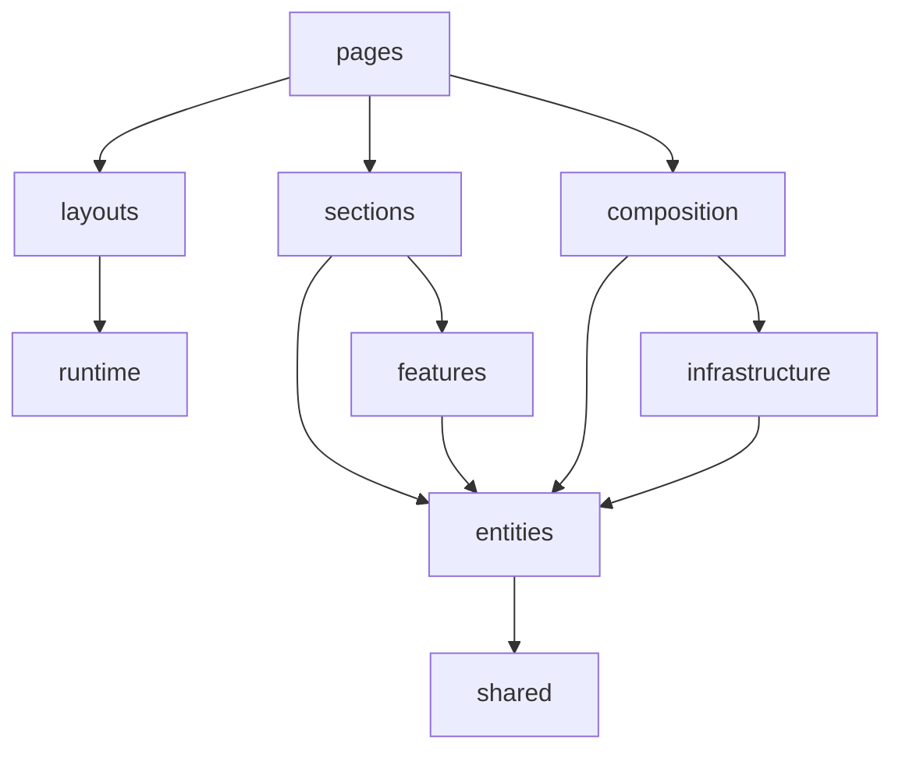

# Architecture

Piccolo is a **static, single-page marketing site** for a fast-food place (pizza, hot dogs, sandwiches, drinks). It
reproduces the layout and motion of a reference reel (see [reference-spec.md](reference-spec.md)) and must work well on
phones, tablets, laptops, desktops and **TVs**. There is no backend, ordering, cart or login: visitors browse, then
call, message or visit.

This document explains how the code is organised and, more importantly, **which rules keep it that way**. Every rule
below is enforced by a tool (see [Quality gates](#quality-gates)), not just by convention. The reasoning behind the big
decisions lives in the [ADRs](adr/README.md).

## Contents

1. [Constraints](#constraints)
2. [System at a glance](#system-at-a-glance)
3. [Layers and dependency rules](#layers-and-dependency-rules)
4. [Folder map and naming](#folder-map-and-naming)
5. [Build time: content to HTML](#build-time-content-to-html)
6. [Run time: enhancements](#run-time-enhancements)
7. [Device and motion model](#device-and-motion-model)
8. [Progressive enhancement and the reveal protocol](#progressive-enhancement-and-the-reveal-protocol)
9. [Styling](#styling)
10. [Quality gates](#quality-gates)
11. [Recipes](#recipes)
12. [Known trade-offs](#known-trade-offs)

## Constraints

| Constraint | Consequence |
| --- | --- |
| Static hosting, no backend | Astro `output: static`; content is JSON validated at build time |
| Must read well without JavaScript | All sections and **every menu category** are server-rendered; JS only enhances |
| Phones to TVs | Behaviour branches on measured capabilities (device, pointer, motion), layout is pure CSS |
| Old TV browsers (Chromium 94 class) | Build target `chrome94 / safari15 / firefox100`; newer CSS and syntax are rejected by lint |
| Small JS budget | Two islands only; GSAP, ScrollTrigger and Lenis are lazy chunks; budgets in `.size-limit.json` |
| Accessible by default | Reduced motion honoured, focus never hidden, axe runs on every device profile |

## System at a glance



## Layers and dependency rules



Every layer may also use `shared`. The dependency policy is the `boundaries/dependencies` rule in
[`eslint.config.js`](../eslint.config.js); anything not allowed there is an error.

| Layer | Lives in | May import | Job |
| --- | --- | --- | --- |
| `pages` | `src/pages` | layouts, sections, features, composition, shared, styles | Compose a page from sections |
| `layouts` | `src/layouts` | runtime, shared, styles | `<html>` shell, SEO, fonts, boot script |
| `sections` | `src/sections/<name>` | entities, features, shared | One visual section: markup, CSS, its scene |
| `features` | `src/features/<name>` | entities, shared | Interactive capability (islands, smooth scroll, TV nav) |
| `entities` | `src/entities/<name>` | shared | Domain model, rules and ports (pure TypeScript) |
| `infrastructure` | `src/infrastructure` | entities, shared | Adapters: content collections, image catalog |
| `composition` | `src/composition` | entities, infrastructure, sections, shared | Build-time root: wires adapters, builds view models |
| `runtime` | `src/runtime` | shared | Browser entry: registry, scheduler, timing |
| `shared` | `src/shared` | itself only | Leaf utilities: bus, device, motion kit, UI atoms |

Consequences worth knowing:

- Sections **cannot** import other sections; features cannot import each other; entities cannot import each other.
  Cross-talk goes through the typed event bus (`shared/events`) or through `composition`.
- `composition` imports `sections/*/types.ts` for prop types only (by convention; keep it to `import type`).
- Only specific files may touch specific tools. These are lint errors anywhere else:

  | Tool | The only place that may use it |
  | --- | --- |
  | `gsap` | `shared/motion/gsap.ts` |
  | `lenis` | `features/smooth-scroll/**` |
  | `astro:content` | `infrastructure/content/**`, `content.config.ts` |
  | `astro:assets` | `infrastructure/images/**`, `layouts/**` |
  | `import.meta.env` | `shared/config/env.ts` |

- `dependency-cruiser` additionally forbids import cycles, dev dependencies in shipped code and unresolved imports.

## Folder map and naming

```
src/
  pages/            index.astro (+ 404)
  layouts/          BaseLayout.astro
  sections/<name>/  <Name>.astro  <name>.module.css  <name>.hooks.ts  <name>.scene.ts  types.ts  index.ts
  features/<name>/  *.island.tsx | *.behavior.ts | controller.ts | types.ts
  entities/<name>/  model.ts  selectors.ts  ports.ts  index.ts   (+ ui/ for shared presentational pieces)
  infrastructure/   content/ (adapters + Zod schemas)   images/ (catalog)
  composition/      container.ts  home.ts  not-found.ts  restaurant-jsonld.ts
  runtime/          boot.ts  registry.ts  scheduler.ts  timing.ts
  shared/           config device enhance events focus lib motion seo ui
  styles/           tokens.css  reset.css  base.css
  content/          site.json  home.json  menu/categories.json  menu/items.json
  assets/           placeholder art (replace with real photos, same base names)
```

| Suffix | Meaning |
| --- | --- |
| `*.hooks.ts` | The **markup contract** of a section: names of its `data-enhance` root and `data-part` parts |
| `*.scene.ts` | Scroll/animation enhancement (GSAP). Default-exports an `Enhancement` |
| `*.behavior.ts` | Interaction enhancement (smooth scroll, TV navigation, open status, ...) |
| `*.island.tsx` | Preact island, hydrated by Astro (`client:idle` / `client:media`) |
| `*.module.css` | CSS Modules: class names are private to the component |
| `types.ts` | Prop types of a section (kept out of `.astro` frontmatter, where exports are fragile) |
| `index.ts` | A layer's public surface. Export only what is consumed (knip enforces this) |

## Build time: content to HTML

```
content JSON ──Zod──▶ collections ──▶ repositories ──▶ composition/home.ts ──▶ sections
```

- `src/content.config.ts` declares four collections (`site`, `home`, `categories`, `items`) with the schemas in
  `infrastructure/content/schemas.ts`. A typo in JSON **fails the build** with a precise message.
- Entities define **ports** (`SiteRepository`, `MenuRepository`); `infrastructure/content` implements them on top of
  content collections. `composition/container.ts` is the only place that knows which adapter is used: swapping in a CMS
  is a change there and nowhere else.
- `composition/home.ts` turns domain data into the exact props each section needs (formatted prices, grouped hours,
  `tel:` links, non-breaking phone numbers, image sources, the JSON-LD for search engines).
- Prices are integer minor units (cents) in the domain and formatted once, in one place.
- Images: `infrastructure/images/catalog.ts` resolves a key such as `food/pizza` to `src/assets/food/pizza.*`. A raster
  file (`png/jpg/webp/avif`) wins over `svg`, so dropping a photo next to a placeholder replaces it.

## Run time: enhancements

The page is complete HTML before any script runs. JavaScript then *enhances* it in this order:

1. **Inline bootstrap** (`shared/device/bootstrap.inline.js`, plain ES5, runs in `<head>` before first paint): measures
   the device and sets `html.js`, `data-device`, `data-motion`, `data-pointer`, arms a 4 s failsafe and listens for
   Astro's `astro:hydration-error`; either one sets `html.no-enhance` (everything shows, the no-JS layout applies).
2. **`runtime/boot.ts`** (the only script every visitor downloads): creates the capabilities store, discovers every
   `*.scene.ts` / `*.behavior.ts` via `import.meta.glob` (eager, they are tiny), and starts the scheduler. It sets
   `window.__PICCOLO_READY__` when done.
3. **`runtime/scheduler.ts`** decides *what* runs (motion tier + an optional `enabled(caps)` gate) and *when*
   (`load`, `idle`, or `visible` = when the root nears the viewport). It re-evaluates on every capability change
   (resize, reduced motion toggled): enhancements that stop qualifying are torn down, new ones start. One failing
   enhancement never affects another.

An enhancement is one object (`shared/enhance`):

```ts
export default defineEnhancement({
  id: 'popular',
  selector: POPULAR.root,          // from the section's *.hooks.ts
  when: 'visible',                 // 'load' | 'idle' | 'visible'
  tiers: ['full', 'lite'],         // default; add 'static' to also run under reduced motion
  enabled: (caps) => true,         // optional extra gate
  async setup({ root, caps, gsap, bus, signal }) {
    const { gsap: g } = await gsap(); // GSAP loads lazily, once, as a shared chunk
    // ... build the animation ...
    return () => { /* teardown */ };
  },
});
```

| Enhancement | Runs on | Purpose |
| --- | --- | --- |
| `about`, `popular`, `menu`, `follow`, `visit` scenes | full + lite tiers, when visible | Scroll-triggered entrances (time-based, once), written with `defineScene` |
| `navbar` | all tiers | Top / hidden / shown states, scroll-spy |
| `smooth-scroll` | full tier, fine pointer, laptop or desktop | Lenis glide, synced with GSAP's ticker |
| `anchors` | all tiers | In-page links scroll and move focus to the target |
| `tv-navigation` | TV only | D-pad moves focus spatially, remote Back closes modals |
| `open-status` | all tiers | "Open now" chips, computed in the restaurant's time zone, refreshed each minute |
| `menu-details` | all tiers | Turns clicks on any card's Details button into a bus event |

**Scenes.** A scroll scene only describes its choreography; `defineScene` and `createScene` (`shared/enhance/scene.ts`,
`shared/motion/scene.ts`) own everything every scene shares:

```ts
export default defineScene({
  id: 'about',
  selector: ABOUT.root,
  start: enter.about,                          // 'top 72%': the viewport line the section's top must cross
  build({ timeline, px, fadeUp }, root) {      // runs once GSAP has loaded
    fadeUp(parts(root, ABOUT.parts.item), { stagger: stagger.copy });
  },
});
```

- One `gsap.context()` holds one ScrollTrigger-linked timeline that plays once in real time (never scrubbed, so it looks the
  same however the visitor scrolls). `revert()` is the whole teardown, and it leaves the root revealed.
- Eases, durations, staggers and travel distances live in `shared/motion/tokens.ts`. Travel is in **rem**, so motion scales
  with the layout (the root font follows the viewport above 1024 px). The lite tier travels half as far and the timeline
  runs a third faster (`scaleFor`); nothing else needs to know about tiers.
- Values that depend on layout are functions (`y: () => px(2)`), and the trigger uses `invalidateOnRefresh`, so a resize
  before the scene plays re-measures instead of reusing stale numbers.
- `recover` is the fail-safe: if a scene cannot run (the GSAP download failed or has not arrived after 6 s, expected markup
  is missing) the scheduler calls it and the section opens instead of staying invisible. A scene that starts after the
  bootstrap's failsafe (`html.no-enhance`) has already shown the page does nothing.
- A frame later than 60 ms counts as 33 ms of animation time (`LAG_SMOOTHING`, set where GSAP loads), so a slow first frame
  delays a scene or a dialog instead of skipping the part of it the hitch covered. Lenis turns this off while it runs (desktop
  with a fine pointer), because it needs real time, and puts the same constant back on teardown ([ADR 0009](adr/0009-first-frame-stalls.md)).
- Never put `clearProps` in a timeline's `defaults` (a `fromTo`'s hidden start-state tween inherits it and wipes the
  from-state), and give a scene's trigger an element the scene does not move (ScrollTrigger measures transforms).

**Markup contract.** Sections declare what they are with `data-enhance="name"` and `data-part="part"`; behaviours find
them through the helpers in `shared/lib/hooks`. Neither side hard-codes the other's class names, so CSS Modules stay
private.

**Event bus** (`shared/events`). Features never import each other; they talk through `appBus`:
`nav:menu`, `menu:details`, `scroll:lock`. `menu:details` is *sticky*: a click
on server-rendered markup before the menu island hydrates is kept and replayed to it, so it is never lost. `scroll:lock`
is not: a dialog that opens before `smooth-scroll` has loaded is found through the `data-scroll-lock` attribute it sets
on `<html>`, which `smooth-scroll` checks once when it starts.

**Islands.** Only two exist: `MobileNav` (`client:media="(max-width: 1023px)"`) and `MenuBrowser` (`client:idle`). The menu
browser server-renders every category panel, so search engines and no-JS visitors get the full menu; the island turns it
into tabs with a quick-view dialog (`shared/focus/use-dialog`: focus trap, Escape, scroll lock, focus returns to the
opener). If an island's code cannot be loaded, the page falls back to the no-JS layout ([ADR 0003](adr/0003-progressive-enhancement-and-reveal-protocol.md)).

Islands are animated with the same GSAP as the scenes. Each feature describes its choreography in a `*.motion.ts`: plain
functions of `(node, tools)` with no framework in them (`mobile-nav.motion.ts`: the circle that grows from the toggle,
`quick-view.motion.ts`, `menu-browser.motion.ts`: the pill that slides between tabs and the cards that rise in). Two hooks
in `shared/motion/island.ts` run them:

- `useMotion()` starts the GSAP download with the island and hands out the tools at the moment an animation starts, or
  `null` (reduced motion, still downloading, download failed). The tier is read then, so reduced motion switched on mid-visit
  is honoured, and a failed download is retried on the next interaction.
- `usePresence(open, motion)` mounts a node in the render that opens it, keeps it mounted until its exit has played, and
  continues from where it is if it is reopened mid-exit. Without GSAP the node carries `data-presence="enter|exit"` and
  `base.css` fades it in 0.18 s: the same fade reduced-motion visitors keep on purpose (they never download GSAP).

## Device and motion model

Classification is a pure function (`shared/device/classify.ts`), mirrored in the inline ES5 bootstrap. **A unit test runs
the real bootstrap script against `classify()` over ~29,000 input combinations**, including every breakpoint boundary, so
the two cannot drift.

| Device | When |
| --- | --- |
| `tv` | TV user-agent token (Tizen, webOS, Fire TV, Android TV, HbbTV, ...), or a >= 1920 px screen with no pointer and no hover |
| `phone` / `tablet` | Touch only (coarse pointer, no hover); phone if the shorter side is under 600 px |
| `laptop` / `desktop` | Otherwise by width: >= 1024 px / >= 1440 px (narrower fine-pointer windows count as `tablet`) |

| Motion tier | When | Behaviour |
| --- | --- | --- |
| `full` | Default | Everything |
| `lite` | TV, data saver, or low-end (<= 2 cores / <= 2 GB) | Shorter, smaller motion; no smooth scroll |
| `static` | `prefers-reduced-motion` | Nothing moves and nothing is pre-hidden |

Layout never depends on device class: it is CSS (media queries and the rem model below). Device class only changes
*behaviour* (smooth scroll, TV navigation, tier).

## Progressive enhancement and the reveal protocol

- **No JavaScript:** nothing is hidden, every menu category is visible.
- **JavaScript, motion allowed:** elements marked `data-reveal` start at `opacity: 0` (plus a small translate), declared
  in `styles/base.css` and only under `html.js:not(.no-enhance)[data-motion='full' | 'lite']`. A scene animates them to
  rest, marks them `data-revealed` the moment it starts, then clears its inline styles.
- **Reduced motion (`static`):** the CSS pre-state never applies; content is simply there.
- **Boot failure:** after 4 s without `__PICCOLO_READY__`, the bootstrap adds `html.no-enhance` and everything shows.
- **A dead island:** when an island's code cannot be loaded, Astro fires `astro:hydration-error` and the bootstrap adds the same
  class: the menu is shown stacked and the buttons that would do nothing (card details, hamburger) are hidden, like without
  JavaScript.
- **Never animate or set `visibility` (or GSAP `autoAlpha`) in reveal code.** Hidden content cannot take keyboard
  focus: tabbing would skip it, or blur an element that was already focused when its tween was set up. Reveals animate
  `opacity` and `transform` only, so content stays focusable and in the accessibility tree. A lint rule enforces this.

The Follow card's expansion is the signature animation: `width` 1.15 rem -> full on `expo.out` over 0.96 s, with the
corner radius held as a stadium for 0.3 s and then relaxing on its own `expo.out` over 0.8 s, while art and text slide
out from the card's centre. It fires once when the card's top reaches 70% of the viewport and then plays out in time
(the reference was scrolled by hand), so it looks identical however the visitor scrolls. To re-check it against these
numbers, run `node scripts/dev/sample-follow.mjs` (it fits the live animation to the spec).

## Styling

- **CSS Modules** everywhere, plus design tokens in `src/styles/tokens.css` (colours, radii, shadows, drop-shadow
  filters, easings, spacing). Components never contain raw colours.
- **rem model.** All lengths are rem. At >= 1024 px the root font size follows the viewport
  (`clamp(87%, 1.1111vw, 280%)`), so 1 rem equals 1/16 of the 1440 px artboard the layout was measured from, and the
  design scales smoothly up to TVs. Below 1024 px it stays at 100%.
- **Browser floor** is enforced by stylelint (`stylelint.config.js`): no `@layer`, `@container`, `@scope`, `:has()`,
  `:is()`, dynamic viewport units, `color-mix()`, individual transform properties, or native nesting (a small custom
  rule, `scripts/stylelint/no-native-nesting.mjs`). A newer value may refine an older declaration written right above it
  with an explicit `stylelint-disable-next-line ... -- reason`.
- **Breakpoints** are `640 / 768 / 1024 / 1440` (`shared/config/breakpoints.ts`); a unit test scans CSS, `sizes`
  attributes, `matchMedia` and `client:media` for any other width.
- Fonts come from the Astro Fonts API: Playfair Display (display), Plus Jakarta Sans (body), Caveat Brush (script).

## Quality gates

`npm run verify` runs everything except the browser tests and stops at the first failure; `npm run verify:all` adds them.

| Command | Guards |
| --- | --- |
| `npm run check` | `astro check`: strictest TypeScript (including `.astro` and tests), 0 errors, 0 warnings, 0 hints |
| `npm run lint` | ESLint: layer boundaries, single-owner imports, no `visibility` in motion code, Astro and Preact a11y, hooks rules |
| `npm run lint:css` | stylelint: tokens only, browser floor, no nesting |
| `npm run arch` | dependency-cruiser: no cycles, no dev dependencies in shipped code, imports resolve |
| `npm run knip` | Unused files, exports and dependencies (barrels may only export what is consumed) |
| `npm test` | Vitest unit tests: classification and bootstrap parity, hours, event bus, scheduler, spatial navigation, selectors, content integrity, JSON-LD, breakpoint sync |
| `npm run build` | Production build (also validates all content against its schemas) |
| `npm run html` | html-validate on the **built** HTML |
| `npm run size` | Size budgets (gzip): HTML 24 kB, boot runtime 6.5 kB, GSAP + ScrollTrigger 48 kB, Lenis 6.5 kB, all JS 85 kB |
| `npm run test:e2e` | Playwright on five profiles (desktop, reference 1253 x 712, phone, tablet, TV with a Tizen UA): boot, hydration, ARIA, focus trap, reveal, no horizontal scroll, TV D-pad, axe a11y, no-JS and reduced-motion, the 404 page, **motion frame by frame** (scenes on desktop and TV, islands on desktop and phone: each must pass through intermediate frames, survive a resize and degrade when GSAP cannot be downloaded) and (on the reference profile) **layout geometry against the reel** |

The unit tests were mutation-checked: deliberately breaking the bootstrap breakpoint, overnight hours, scheduler
guards, bus replay, D-pad weighting, price labels and `tel:` links each makes a test fail.

## Recipes

**Edit copy, hours, links, menu.** Edit `src/content/*.json`. The build validates them. Prices are in major units
(8.5 = 8.50) and converted to cents.

**Replace placeholder art.** Put real files in `src/assets/<group>/<name>.png|jpg|webp|avif` using the same base name as the
placeholder SVG; the raster wins. `npm run art` regenerates the placeholders.

**Add a menu item.** Append to `src/content/menu/items.json` with an existing `category` and an `image` key that has
a file under `src/assets` (the build fails otherwise). To feature it on the home page set `"popular": true`.

**Add a section.** Create `src/sections/<name>/` with `<Name>.astro`, `<name>.module.css`, `<name>.hooks.ts` (root +
parts), `types.ts`, `index.ts`; build its props in `composition/home.ts`; add it to `pages/index.astro`. Add a
`<name>.scene.ts` if it animates (it is discovered automatically).

**Add a scene.** Create `<name>.scene.ts` next to the section (it is discovered automatically) and default-export
`defineScene({ id, selector, start, build })`. `build` gets the scene's `timeline` and helpers (`fadeUp`, `px`); take eases,
durations and distances from `shared/motion/tokens.ts`. Animate `opacity` and `transform` only.

**Add a behaviour.** Default-export `defineEnhancement({...})` from `*.behavior.ts`: return a teardown, and load GSAP
through the `gsap` function on the context if you need it.

**Animate an island.** Put the choreography in a `*.motion.ts` in the feature, as functions of `(node, tools)`, and drive
it with `usePresence` (a node that comes and goes) or `useMotion` (everything else) from `shared/motion/island`. Always
leave the node in the state its stylesheet describes: end tweens with `clearProps`.

**Add a bus event.** Add it to `AppEvents` in `shared/events/events.ts` (and to the `sticky` list only if a message must
survive having no listener yet).

**Add a token.** Add it to `src/styles/tokens.css`; use `var(--...)` in components.

**Change the layout on purpose.** `tests/e2e/reference.spec.ts` compares the boxes of the key elements (hero, about,
popular, follow card, footer) with a baseline that was verified against the reel, tolerance 2 px. When a layout change is
intended: re-check it against the reel (`node scripts/dev/scan.mjs`, then `python scripts/dev/match_frames.py`, which
finds the scroll position where the page best matches each reel frame and writes side-by-side images), then regenerate
the baseline with `UPDATE_GOLDEN=1 npx playwright test --project=reference` and review the diff of
`tests/e2e/reference.golden.json`.

## Known trade-offs

- **Scene starts hitch in software-rendered Chrome.** A Chrome trace shows every stall over 40 ms is a GPU-process task
  (uploading the textures of the large layers that start animating, the About cluster first), while the main thread's
  longest task is about 10 ms. Verify smoothness on a real GPU and a real low-end TV.
- **Paint cost of the Follow card.** In software-rendered headless Chrome its first ~100 ms shows style/layout/paint
  stalls (no JavaScript involved), from re-rasterising the large soft shadow and the art's `drop-shadow` filters while the
  card morphs. Verify smoothness on a real GPU and a real low-end TV; if needed, simplify the shadow during the tween.
- **Phone menu tabs** scroll horizontally (the fourth tab is clipped at 390 px, signalling "swipe"). A deliberate
  alternative would be wrapping or shortening labels.
- `composition` -> `sections` is allowed for prop **types**, but the lint rule cannot yet restrict it to type-only imports.
